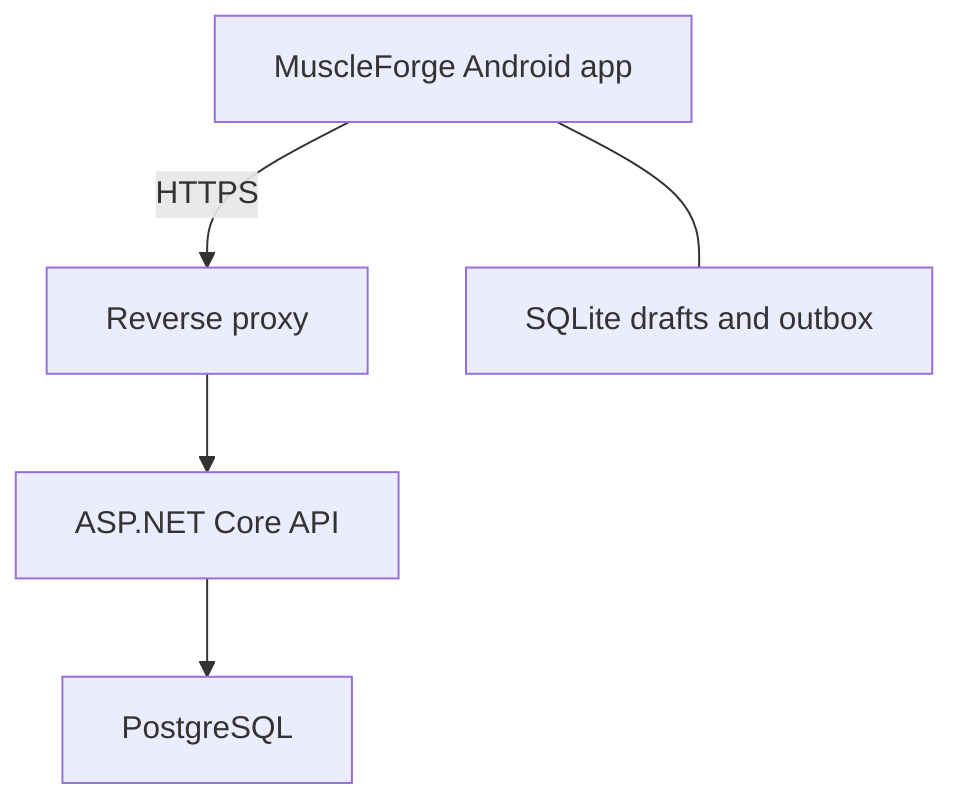

# MuscleForge — Technical Architecture and Agent Handoff

Date: 2026-11-01  
Status: Revised baseline — two repositories, native .NET MAUI Android app  
Audience: The developer and an AI coding agent

Owner decision, 2026-11-13: development and native acceptance use physical Android phones. Emulator work is excluded from scope. Apply the current feature development guidelines when interpreting older verification references in this baseline.

## 1. Product goal and requirements

The product name and Android display name are **MuscleForge**. Use `MuscleForge` for .NET project/namespace prefixes and `muscleforge` for repository/artifact naming. Choose a stable Android application ID before the first signed release; do not invent a domain ownership claim.

Build MuscleForge, a personal workout tracker, for a C# backend developer who wants a useful, finished portfolio project. The primary device is an Android phone. Plan workouts, log sets quickly at the gym, and review progress.

Requirements: separate frontend and backend Git repositories, a C# backend, a C#-relevant frontend using .NET MAUI, workout planning/tracking, historical data, and a mobile-friendly Android experience. Use native MAUI controls with C# and XAML. React and a browser frontend are no longer part of this architecture. Do not substitute Blazor Hybrid or a WebView UI without an explicit architecture decision.

Install a signed Android APK for personal use initially. Play Store publication is optional later. The native app calls a separate ASP.NET Core API and keeps drafts in local SQLite. Installation does not implement offline sync automatically. Android can suspend or terminate the process; persistence cannot depend on lifecycle callbacks or guaranteed background execution.

## 2. Scope and release boundaries

### First usable release: milestones 1–2

- Owner account provisioned through a secure CLI; no public registration.
- Personal exercise catalog with common seeded exercises and custom exercises.
- Workout templates with ordered exercises and prescribed sets.
- Start from a template or an empty workout.
- Record weight, reps, warm-up/working type, completion, and optional notes.
- Show previous performance while logging.
- Finish workouts and view history and simple progress charts.
- Adaptive native UI and signed APK installed on the owner's Android phone.
- Persist active drafts locally before network requests. Starting and finishing require connectivity initially; retain and clearly identify unsent edits.

### Resilient gym release: milestone 3

- Continue logging and reopen an already-started workout offline.
- Durable queue, safe replay, recoverable authentication expiry, and explicit conflicts.
- Offline completion remains visibly pending until the server accepts it.

### Later

Explainable progression suggestions, estimated 1RM, timed/distance exercises, full data export, offline session creation/template editing, wearables, notifications, and other native platforms. A browser client, social features, nutrition, and AI coaching are outside the initial scope.

## 3. Technology and runtime decisions

| Area | Decision | Reason |
| --- | --- | --- |
| Backend | .NET 10 LTS, ASP.NET Core REST API | C# backend portfolio focus |
| Server shape | Modular monolith; one process | Clear boundaries without distributed infrastructure |
| Frontend | .NET MAUI 10, native C# + XAML, Android first | Relevant C# skills and native mobile interaction |
| Presentation | MVVM with CommunityToolkit.Mvvm, MAUI Shell | Testable presentation logic and navigation |
| Networking | Typed HttpClient behind an application interface | Cancellation, auth, and errors handled consistently |
| Server persistence | PostgreSQL, EF Core, Npgsql | Transactions, constraints, and migrations |
| Device persistence | SQLite through sqlite-net-pcl | Durable drafts, cached working set, and outbox |
| Authentication | ASP.NET Core Identity's built-in bearer access/refresh tokens | Framework-managed first-party authentication |
| Secret storage | MAUI SecureStorage | Platform-protected refresh credentials |
| Contract | Backend-owned versioned OpenAPI; frontend-generated C# client/DTOs | Independent repositories connected through an explicit HTTP contract |
| Repository boundary | muscleforge-backend and muscleforge-frontend | Independent solutions, CI, releases, and deployment |
| Tests | xUnit, ASP.NET Core test host, Testcontainers, Appium | Domain, real database, API, and native UI coverage |
| Delivery | Docker Compose for API/database; signed APK for Android | Independent backend and mobile deployment |

Use stable compatible packages, pin versions, and commit applicable lockfiles. Pin the .NET SDK and document MAUI workload, Android SDK, and JDK versions. Keep EF Core and Npgsql compatible. MAUI has its own support lifecycle: .NET 10 LTS does not imply that MAUI 10 has the same support lifetime. Recheck the official MAUI support policy before implementation and upgrades.

Do not add microservices, a message broker, Kubernetes, event sourcing, MediatR, or generic repositories by default.



The API serves no application frontend. The app uses a configurable HTTPS API base URL and never connects directly to PostgreSQL. Only the reverse proxy is exposed publicly; the database stays on a private container network. CORS is a browser policy, not a native HttpClient requirement; do not enable wildcard CORS to resolve phone connectivity issues.

## 4. Two repositories and code boundaries

Use exactly two independently buildable Git repositories. Repository names below are suggested names; do not create repositories until implementation is requested. Each has its own solution, SDK configuration, tests, README, decisions, and CI. There is no root solution spanning both repositories, no Git submodules, no cross-repository project references, and no shared source folder.

### Backend repository: muscleforge-backend

```text
MuscleForge.Backend.sln
src/
  MuscleForge.Api/             # HTTP endpoints, auth, middleware, composition
  MuscleForge.Core/            # Domain, use cases, narrow persistence interfaces
  MuscleForge.Infrastructure/  # EF Core, Identity, persistence implementations
tests/
  MuscleForge.UnitTests/
  MuscleForge.IntegrationTests/
contracts/
  openapi.json                    # Exported HTTP contract
docs/
  architecture.md
  decisions/
Dockerfile
compose.yaml
global.json
README.md
.github/workflows/ci.yml
```

The backend owns domain rules, authorization, authoritative data, PostgreSQL migrations, authentication, history calculations, mutation receipts, and the HTTP contract. Its deployment resources, database backups, and server secrets stay here.

Core has no EF Core or ASP.NET Core dependency. Infrastructure references Core; API references both and composes dependencies. Organize features as Exercises, Templates, Sessions, and Progress. Use explicit use-case services and narrow workflow-shaped persistence interfaces; avoid generic repositories. Three projects are sufficient initially; a separate Application project is not required.

### Frontend repository: muscleforge-frontend

```text
MuscleForge.Frontend.sln
src/
  MuscleForge.Mobile/          # MAUI XAML views, Shell, Android/platform adapters
  MuscleForge.Mobile.Core/     # UI-independent view models, sync, local interfaces
  MuscleForge.Client/          # Generated C# HTTP client and DTOs
tests/
  MuscleForge.Mobile.UnitTests/
  MuscleForge.Mobile.UiTests/   # Appium Android smoke tests
contracts/
  openapi.json                    # Pinned copy from a backend release/commit
  source.json                     # Backend version/commit and contract SHA-256
scripts/
  generate-api-client.*           # Reproducible generation using a pinned tool
docs/
  architecture.md
  decisions/
global.json
README.md
.github/workflows/ci.yml
```

The frontend owns native interaction, navigation, local database migrations, draft/outbox storage, synchronization orchestration, API consumption, token storage, and signed Android artifacts. It does not own server business rules or server schema. Client-side validation helps interaction; the server independently validates all writes.

Mobile references Mobile.Core and Client. Mobile.Core may reference the platform-neutral Client library but stays free of MAUI types. Implement SQLite, SecureStorage, connectivity, and lifecycle adapters in Mobile and inject interfaces. Keep platform-independent logic testable without an emulator.

Use CommunityToolkit ObservableObject and async commands. Views bind to view models; do not put network/database workflows in code-behind. Use cancellation and async I/O without blocking the UI thread. One injected sync coordinator owns replay. Map generated API DTOs to local/display models; never share server EF entities or domain assemblies with the frontend.

### Contract ownership and change workflow

The OpenAPI document is the integration boundary, not a shared C# project or a third contracts repository. The backend owns request/response DTO definitions and exports contracts/openapi.json. The frontend commits a pinned copy and generates its C# client from that copy. A frontend build must not contact the running backend or fetch a moving main/latest contract. A shared NuGet package is unnecessary initially.

1. Implement and test an API change in the backend; export OpenAPI reproducibly and commit the diff. Include auth endpoints and stable Problem Details schemas/error codes.
2. Review compatibility with the currently supported installed app. Publish the exact specification as a versioned backend release artifact; for unreleased coordinated development, use an explicit backend commit.
3. In a frontend change, deliberately update the contract snapshot and source.json with the backend release/commit and SHA-256. Regenerate using the pinned tool, review the diff, and update relevant client behavior/tests.
4. Deploy additive server changes before shipping a client that uses them. Keep old installed clients working; optional additions must not silently become required.
5. A breaking change needs a compatibility plan, normally a new API major path while the old version remains supported. API path version (/api/v1) and release version are separate. Do not require every backend and frontend release to have matching version numbers.

Record compatibility in each release: backend API version, frontend version, pinned contract revision, and any required minimum server version. Document mutation semantics beyond the schema, especially retry identity, version conflicts, and completion states. Cross-repository changes may need two coordinated pull requests; neither repository assumes an atomic commit spanning both.

### Independent development and CI

Backend CI builds/tests the API, validates migrations, verifies that exported OpenAPI matches the committed contract, flags breaking contract differences against the supported baseline, and builds its container image. It needs no MAUI workload.

Frontend CI builds/tests the platform-independent code, verifies generated-client drift from its committed OpenAPI snapshot, builds Android, and signs release artifacts using frontend-only secrets. It needs neither server source nor PostgreSQL for normal unit tests/builds.

For end-to-end testing, the frontend may start a pinned published backend container with an isolated test database. The backend repository owns the reusable server image; the frontend owns emulator/device test orchestration. Local full-stack development can use two sibling checkouts, but each repository also supports its own documented workflow. The frontend can build against a fake API and run against a configured deployed API without the backend checkout.

Keep this architecture document in docs/architecture.md in both repositories as an explicitly versioned baseline when implementation starts. Update both through normal changes for cross-cutting decisions; do not imply automatic synchronization. Each README links to the other repository. Repository-specific instructions apply only within that repository.

## 5. Data model and invariants

Use UUID identifiers. Session, session-exercise, and set identifiers are client-generated so retries and future offline work can address the same records. Identity IDs can follow the configured Identity key type. Store timestamps as UTC instants and retain the session's IANA timezone for local-day reporting. Use decimal values for weight and database numeric columns, never floating point.

| Entity | Main fields and relationships |
| --- | --- |
| User | Identity account; display weight unit and timezone preferences |
| Exercise | Id, OwnerId, Name, Equipment, TrackingType, ArchivedAt |
| WorkoutTemplate | Id, OwnerId, Name, Version, ArchivedAt |
| TemplateExercise | Id, TemplateId, ExerciseId, Position, RestSeconds |
| TemplateSet | Id, TemplateExerciseId, Position, SetType, TargetRepsMin/Max, optional TargetWeightKg |
| WorkoutSession | Id, OwnerId, optional SourceTemplateId, template-name snapshot, StartedAt, TimeZone, FinishedAt, Status, Version |
| SessionExercise | Id, SessionId, ExerciseId, Position, exercise-name/equipment/tracking snapshots, RestSeconds |
| WorkoutSet | Id, SessionExerciseId, Position, SetType, TargetRepsMin/Max snapshot, optional TargetWeightKg snapshot, WeightKg, Reps, IsCompleted |
| MutationReceipt | OwnerId, MutationId, RequestHash, SessionId, ResultVersion, acknowledgement, CreatedAt |

Owner-scope every aggregate. Child resources inherit ownership through their parent. Verify every referenced exercise belongs to the current user. Seed common exercises as per-user copies in the initial version; a shared public catalog is unnecessary.

Rules:

1. A session copies its template structure and prescriptions when started. Later template edits do not alter active or completed sessions. Exercise renames do not rewrite historical labels.
2. Initial tracking type is external-weight-and-reps only. Zero external weight is valid; negative weight is invalid. Bodyweight accounting, assisted movements, timed sets, and distance need explicit future models.
3. Convert pounds to canonical kilograms at the API boundary using decimal arithmetic; keep display preferences separate. Validate precision and round only according to documented conversion/storage rules. Record whether external weight means total load or per dumbbell in exercise guidance; do not compare different conventions as the same exercise.
4. Draft sets can have null actuals. Completed sets require nonnegative weight and positive integer reps. Completion of a workout requires at least one completed working set.
5. Session states: `InProgress -> Completed` or `InProgress -> Discarded`. Completed/discarded sessions are immutable initially. Completing records the timestamp and is part of the versioned session update.
6. Allow one active session per user. Enforce using a PostgreSQL partial unique index on OwnerId for InProgress status. Starting again returns a conflict with the existing session ID.
7. Archive exercises/templates instead of deleting referenced records. An archived exercise remains available to historical sessions and an already active session, but cannot be newly added to templates/sessions.
8. Validate resource limits, including names, notes, exercises/session, and sets/exercise. Establish reasonable documented bounds in milestone 1; cap session update bodies at 256 KiB initially.

Database constraints must reinforce foreign keys, unique ordering within parents, valid numeric ranges, and ownership where practical. Use transactions for aggregate writes. Index `(OwnerId, StartedAt)`, session-exercise ExerciseId, and receipt lookup `(OwnerId, MutationId)`; paginate history and verify real query plans before adding more indexes.


## 6. API and write semantics

All application endpoints live under `/api/v1`. Use JSON DTOs, explicit validation, and Problem Details with stable error codes and trace IDs. Do not serialize EF entities directly. Return 401 for unauthenticated API requests, not HTML redirects. Use 404 for another user's resource and 409 for version/state conflicts. History uses cursor pagination ordered by `(StartedAt, Id)`.

| Endpoint | Purpose |
| --- | --- |
| POST `/auth/login` | Return framework access/refresh tokens; cookies disabled |
| POST `/auth/refresh` | Exchange refresh token for new credentials |
| GET `/auth/me` | Resolve current account identity |
| GET/POST `/exercises` | List/create personal exercises |
| PUT `/exercises/{id}` | Update/archive an exercise |
| GET/POST `/templates` | List/create templates |
| GET/PUT `/templates/{id}` | Fetch/update a complete template with expected version |
| PUT `/sessions/{id}/start` | Idempotently create an online session from a template ID + expected template version, or empty session |
| GET `/sessions/active` | Fetch active session |
| GET `/sessions` | Paginated completed history |
| GET `/sessions/{id}` | Fetch authoritative session and version |
| PUT `/sessions/{id}` | Replace editable session content/state with expected version and mutation ID |
| GET `/exercises/{id}/history` | Completed working sets for that exercise |
| GET `/exercises/{id}/progress` | Date-series highest weight and volume |

For start requests, use the client session ID as the retry key. Repeating the same start input returns the existing session without resetting it; different input with the same ID is a conflict. Copy a template within a transaction and reject a stale expected template version.

Session updates contain `mutationId`, `expectedVersion`, and the full editable aggregate: ordered exercises, prescriptions, sets, notes, and requested state. Server-owned fields such as OwnerId, current version, and provenance cannot be changed by the body. Use a bounded full-aggregate update for simplicity; do not add a separate synchronization protocol.

Use an application-managed integer Version as an EF concurrency token. Every accepted update increments it atomically. A stale version returns 409 and the current server version. Finalization uses the same update mechanism, so it cannot race with a separate finish endpoint.

For each update, scope the mutation ID to the authenticated user. In one database transaction, check receipt, validate version/state, update the session, and insert the receipt. Store a hash of the submitted semantic request. A matching retry returns the original acknowledgement; reuse with different input returns 409. Check the receipt before rejecting a now-terminal session. Handle concurrent duplicate receipt inserts by rolling back and reading the winning receipt. Retain receipts for the initial project's lifetime; document later retention before changing this guarantee. Acknowledgements return accepted mutation ID and version; GET returns current state.


## 7. Native Android interaction

- Target Android first with net10.0-android. Start from supported MAUI template defaults; document the minimum Android API and target SDK after checking the current toolchain and the owner's phone.
- Design for compact phones around 360–430 device-independent pixels wide; use adaptive layouts, with no horizontal scrolling.
- Use Shell navigation for Workout, Templates, and History, plus settings.
- Prioritize one-handed logging: large inputs, previous sets in context, and one clear complete-set action.
- Use at least 48 device-independent units for touch targets. Provide SemanticProperties, TalkBack support, sufficient contrast, and accessible save/sync announcements.
- Use numeric Entry keyboards, but explicitly parse/validate decimals under Dutch and English locales. Test separators on the real Android keyboard and convert display units explicitly.
- Persist each logical edit to SQLite. Recover after app switching, rotation, process death, and keyboard dismissal. Never rely only on in-memory bindings or an eventual OnSleep callback.
- Show Saved on device, Syncing, Synced, and actionable errors/conflicts. A server acknowledgement is required before claiming Synced.
- Store a rest-timer deadline and calculate remaining time on resume. Do not assume a timer callback runs while the screen is locked; reliable alarms/background notifications require separate Android work later.
- Test system back navigation, keyboard occlusion, system insets, font scaling, dark/light themes, splash/icons, and loading/error/empty states.
- Upgrade the local database before exposing editable screens; migrations must preserve drafts and outbox. Test an app update over a populated installation.
- MAUI does not produce a browser app. Other native targets need their own toolchain and verification, and are outside the first release.

## 8. Local persistence and synchronization

Implement local drafts in milestone 2, then durable offline replay in milestone 3. Use the same local model throughout.

1. Online start fetches authoritative session, previous performance, and required exercise metadata. Store this working set in SQLite under the authenticated account ID.
2. Commit each logical edit as a local draft revision before reporting local-save success. Network sending may be debounced; local persistence must not wait for a network response. Surface disk-full and database failures immediately.
3. Keep one immutable in-flight mutation per session and a newer editable draft. Persist the exact request and mutation ID before sending; retain it until acknowledgement or explicit conflict resolution.
4. Use one app-scoped coordinator and per-session async lock so resume handlers, reconnect callbacks, and commands cannot overlap writes. On restart resend the persisted in-flight request first. After acknowledgement advance the base version, then send the latest draft with a new mutation ID. Never replace later local edits with an earlier acknowledgement.
5. Replay on app startup, foreground/resume, reconnect, and manual retry. MAUI connectivity events are hints; a connected network does not guarantee API reachability. Use bounded backoff with jitter for transient errors; pause on validation errors. Android background scheduling is optional later and is not a reliability dependency.
6. Offline finish records Completed locally and queues the versioned change. Show Completed on device — pending sync. Server history/progress changes only after acceptance. Resume an already cached session offline; starting a new session requires connectivity in the initial resilient release.
7. On 401, pause writes and attempt one coordinated token refresh. Concurrent callers await that refresh. Persist renewed credentials before using them for future refresh. If refresh fails/expires, require online login. Resolve /auth/me before replay and continue only for the original account. Offline cached identity is never authorization.
8. On 409, preserve local and remote copies and show differences. Allow keeping remote after explicit local-discard confirmation, or exporting the local draft. If remote is still InProgress, explicit user-confirmed replacement can submit local content against the latest version with a new mutation ID. Never silently merge or overwrite completed history.
9. Partition SQLite data by account. Before logout require synchronization or explicit export/discard of pending edits; then erase credentials and local account data. Never send one account's outbox with another account's token.
10. SQLite is in the app-private directory but is not encrypted by default; do not claim otherwise. Tokens belong in SecureStorage, never SQLite. Configure Android backup exclusions for account caches and SecureStorage to prevent stale outbox restoration and encrypted-key restore failures. Missing/corrupt credentials require login without silently discarding local drafts.

Uninstalling or clearing app data removes unsynced workouts. Local persistence is not a backup. Define explicit local schema versions/migrations; do not drop and recreate the database on startup or after upgrade.

## 9. History and progress definitions

Calculate progress from completed, non-discarded sessions and completed working sets only. Exclude warm-ups. Show highest external weight and session volume (`sum(weightKg * reps)`), grouped per exercise ID. Volume is a simple external-load metric and is not comparable across different exercises or load conventions. Use the session's recorded timezone to determine its local day.

Fetch previous performance from the most recent completed session containing the same exercise; display raw sets rather than an unexplained score. Query the database on demand initially. Avoid materialized analytics tables until measurement justifies them. Progression recommendations remain a later feature with separately documented rules and tests.


## 10. Authentication, deployment, and operations

### First-party native authentication

Use ASP.NET Core Identity's password hashing and lockout. Login and refresh use its built-in bearer support with cookies disabled. These are opaque framework tokens, not JWTs and not an OAuth/OIDC authorization server. Expose only required endpoints; do not enable public registration by unconditionally exposing the entire Identity endpoint set.

Send access tokens in the Authorization header over HTTPS. Keep access tokens in memory and refresh tokens in MAUI SecureStorage. Never store passwords, tokens in SQLite/Preferences, or credentials in source/logs. Start with a 15-minute access lifetime and 14-day refresh lifetime; document exact configuration and framework behavior. Handle SecureStorage read/write failures explicitly.

Logout initially clears local credentials after pending-edit resolution. Local logout does not revoke an already stolen access token. Built-in tokens are not a custom per-device revocation/rotation-replay-detection service: do not claim those guarantees. Use an account security-stamp update to invalidate refresh sessions after compromise; existing access tokens expire normally. A future federated/third-party scenario should use an OIDC provider and Authorization Code + PKCE.

This native bearer-only API does not use ambient browser cookies, so browser antiforgery is outside this baseline. A future cookie-based browser client needs its own CSRF design.

### Backend operations

- Authorize every resource and referenced child ID by the current account. Rate-limit login/refresh. Return API 401 responses without redirects.
- Secrets come from deployment configuration, outside source control. Persist and protect ASP.NET Data Protection keys across restarts so framework tokens remain valid.
- Use structured logs with route, duration, trace ID, and error code. Exclude request bodies, passwords, tokens, and personal workout notes.
- Provide liveness/database-readiness checks without public diagnostic detail.
- Build the API in a multi-stage Dockerfile; use Compose for API, PostgreSQL, TLS proxy, and persistent database/Data Protection volumes. Use an unprivileged container where feasible.
- Apply EF migrations in an explicit deployment step with a backup first, not opportunistically from every running instance.
- Configure daily encrypted database backups to a separate location with retention. Document and verify a restore before treating deployment as ready.
- Portfolio/demo accounts use synthetic data in an isolated environment with periodic reset. Keep personal workout data private.

### Android build and installation

- Build the mobile app separately on a runner with pinned MAUI workload, JDK, and Android SDK. Docker Compose is for the backend, not the native UI.
- Emulator localhost refers to the emulator; use an appropriate host alias when developing against the host. A physical phone requires a reachable LAN/VPN/HTTPS API address.
- Use trusted development certificates and debug-only networking configuration as needed. Never globally disable certificate validation or ship permissive cleartext settings.
- Keep APK signing keys/passwords in CI secrets with a secure recoverable backup. Preserve the application ID and signing identity so updates install over existing data.
- Produce a signed APK for personal installation. Produce an AAB only when Play Store distribution is chosen. The first release needs no store account.
- Backend and APK updates are separate: retain API compatibility for installed versions or communicate a minimum supported client version before changing contracts.

## 11. Verification and acceptance

Unit-test server invariants, state transitions, decimal conversion, and progress calculations. Integration-test real PostgreSQL using Testcontainers: migrations, ownership isolation, snapshots, retries, version races, and transactional rollback.

Unit-test Mobile.Core view models, synchronization, authentication refresh coordination, and injected storage behavior without MAUI runtime dependencies. Test SQLite transactions and migrations using a real SQLite database with a compatible provider/runtime. Use Appium for the native critical path with stable automation/accessibility IDs; verify final lifecycle/network behavior on a real Android phone.

Required scenarios:

- Create a template, start, log, finish, and view accurate history.
- Editing/archiving exercise/template data does not rewrite historical snapshots.
- Accounts cannot access or attach each other's resources.
- Lose the response after a successful save; replay acknowledges exactly one mutation.
- Two clients edit the same version; one succeeds and the other recovers from 409.
- Disable connectivity mid-workout, log sets, force-stop/reopen, reconnect, and sync without loss in milestone 3.
- Expire access credentials during replay; concurrent requests coordinate one refresh and preserve edits.
- Simulate failed refresh, API/database failure, disk-full/local write errors, and SecureStorage failure; retain recoverable drafts and show honest status.
- Check keyboard locales, scrolling, app switching, rotation, installation, and upgrading a populated APK on Android.

Each repository runs its own CI as specified in section 4. Backend CI runs server tests/build, contract export checks, and container build. Frontend CI runs platform-independent mobile tests, pinned-contract/client drift checks, and Android build with the pinned workload. Run UI smoke tests in an emulator-capable job; if unavailable, document the physical-device checks rather than reporting tests that were not run. Commit migrations and generated client changes. Document exact backend startup, mobile build, API URL, account provisioning, and APK installation steps.

## 12. Implementation sequence for the coding agent

| Milestone | Deliverable | Exit criterion |
| --- | --- | --- |
| 1. Foundation | Two repositories/solutions and independent CI; API/PostgreSQL/Identity/exercises; MAUI/MVVM skeleton consuming pinned OpenAPI | Each checkout builds independently; login and ownership checks pass |
| 2. First usable app | Templates, online sessions, SQLite drafts, native history/progress, signed APK | Complete a workout on Android; restart recovers draft |
| 3. Gym resilience | Offline working set, durable outbox, idempotency, conflict UX | Offline, response-loss, expired-login, and conflict scenarios pass |
| 4. Portfolio finish | Readme, Android screenshots, demo APK/API, decisions, backup/restore evidence | Reviewer can install/run the app and understand the tradeoffs |
| 5. Optional progression | Explainable rule-based suggestions | Rules documented and tested against actual use |

Agent instructions:

1. Read the active repository's instructions, then implement milestone 1 in thin end-to-end increments. Respect the two-repository boundary in section 4; do not combine them into a monorepo or create a third shared-contracts repository. This is an architecture handoff, not an instruction to implement every milestone at once.
2. Introduce client-generated IDs, version tokens, and receipt semantics before offline support requires them. Keep the first release small.
3. Keep views simple and domain/use-case logic testable. No business workflows in code-behind and no direct database access from views.
4. Record material deviations in short architecture decisions. Ask only when a decision changes scope, cost, platform, or data semantics; handle routine implementation choices independently.
5. Test behavior and failure cases, run appropriate checks, and report actual results.
6. Never silently discard workouts, fake successful synchronization, bypass ownership checks, or add infrastructure solely for appearance.

## 13. Primary references

These sources support platform capabilities. Product boundaries and architectural choices are recommendations for this project.

- .NET support: https://dotnet.microsoft.com/en-us/platform/support/policy
- MAUI support (separate lifecycle): https://dotnet.microsoft.com/en-us/platform/support/policy/maui
- MAUI supported platforms: https://learn.microsoft.com/en-us/dotnet/maui/supported-platforms?view=net-maui-10.0
- MAUI SQLite databases: https://learn.microsoft.com/en-us/dotnet/maui/data-cloud/database-sqlite
- MAUI SecureStorage and Android backup considerations: https://learn.microsoft.com/en-us/dotnet/maui/platform-integration/storage/secure-storage?view=net-maui-10.0
- Identity bearer endpoints: https://learn.microsoft.com/en-us/aspnet/core/security/authentication/identity-api-authorization?view=aspnetcore-10.0
- ASP.NET Core integration tests: https://learn.microsoft.com/aspnet/core/test/integration-tests?view=aspnetcore-10.0

Recheck official documentation and compatible versions when implementation starts. This document describes architecture; the application has not yet been implemented or device-tested.
